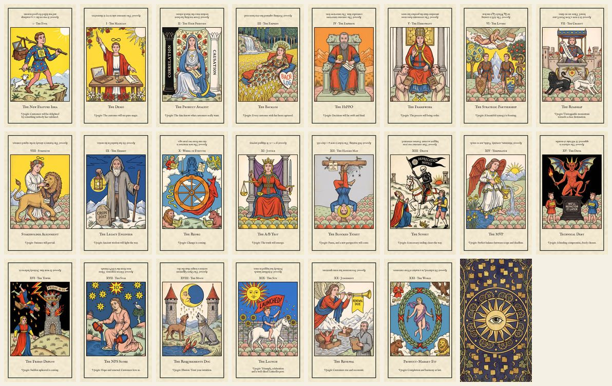
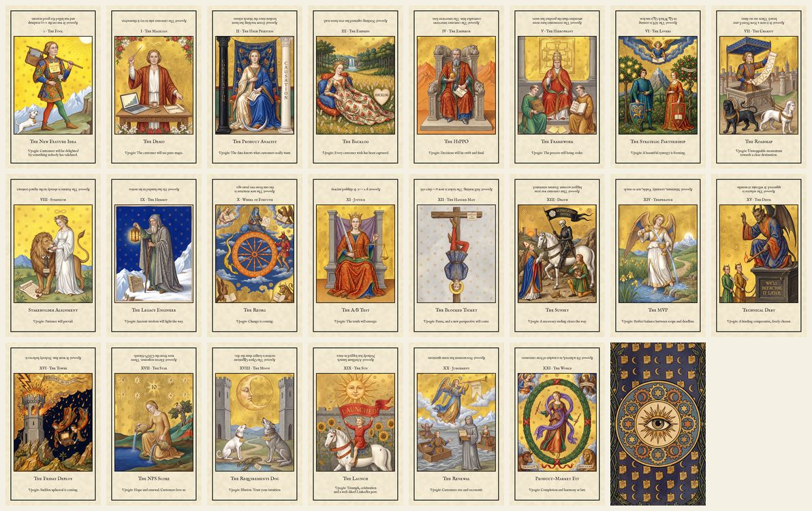

# The Product Arcana: print files

A 22-card tarot deck with a tuck box, in two art styles. Each style folder has everything needed to print one complete deck and its box.

| Style | Preview |
|---|---|
| **Marseille** (woodcut) |  |
| **Visconti** (gilded) |  |

## Files

Each of `marseille/` and `visconti/` contains:

| File | What it is |
|---|---|
| `cards-a3.pdf` | The 22 cards on **A3**, 10 per sheet: 3 sheets, 6 pages (front, back, front, back, ...) |
| `cards-sra3.pdf` | The same cards on **SRA3**, 12 per sheet: 2 sheets, 4 pages. Use this instead if you can print SRA3. |
| `box-a4-depth12.pdf` | Tuck box for the deck on **A4**. Page 1 is the artwork; page 2 is an assembly guide. |
| `box-a4-depth16.pdf` | The same box, 16 mm deep instead of 12 mm, for laminated cards |

To download a file, click it, then click the download button (top right of the file view).

## Printing the cards

- **Stock:** 300–350gsm silk or matt card.
- **Colour, double-sided, at 100% / actual size.** No scaling or "fit to page".
- **Duplex:** flip on either edge. Every slot on the back pages has the same, symmetrical card back, so it lines up whichever way the sheet turns.
- **Cutting:** guillotine to the crop marks. Each card is **70 × 120 mm** trimmed, with 3 mm bleed on every edge, so there is a 6 mm gutter between neighbouring cards and every gap needs two cuts.
- Files are PDF at 300 dpi, RGB.

## Printing the box

- **Page 1 only**, single-sided, on **A4 card** (300–350gsm), at **100% / actual size**.
- Use `box-a4-depth12.pdf` unless the cards are laminated.
- No cutting or creasing is needed from the printer: the box is cut out and folded by hand. Page 2 is an optional assembly guide, which can go on plain paper.
- Finished box: inner size 72.5 × 122.5 × 12 mm (or 16 mm).
